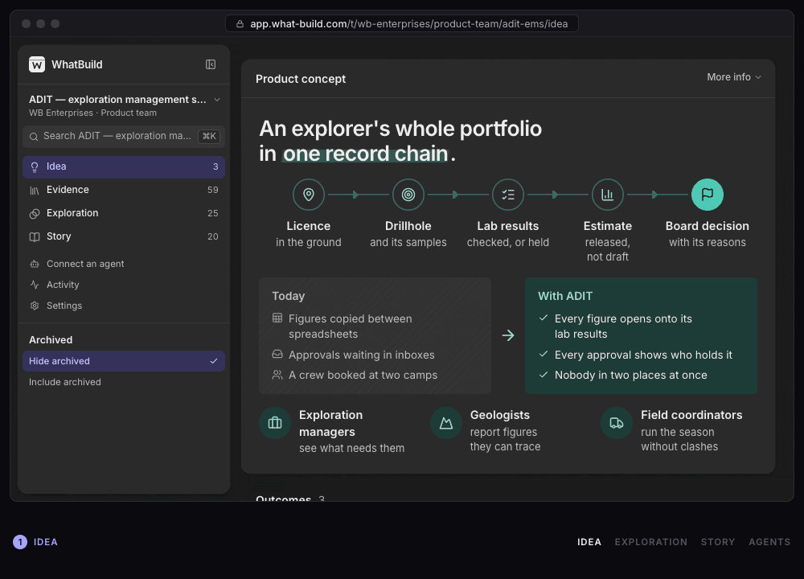

<p align="center">
  
</p>

<h1 align="center">WhatBuild</h1>

<h3 align="center">What to build?</h3>

<p align="center"><strong>Product discovery at the speed of AI Engineering.</strong></p>

<p align="center">
  WhatBuild accelerates collaborative agentic discovery, facilitates alignment, and tells the story
  of your build. At the finish line, WhatBuild provides context to your ticket-creation agent so
  that your team can hit the ground running.
</p>

<p align="center">
  <a href="https://what-build.com">Website</a> ·
  <a href="#run-it-yourself">Run it yourself</a> ·
  <a href="okf/index.md">Documentation</a>
</p>

## From idea to story

| | |
|---|---|
| **Idea** | Say who it’s for and the outcomes you want. |
| **Evidence** | Gather user research, team discussions and documents. |
| **Exploration** | Mock up directions and review the assumptions behind them. |
| **Story** | Show stakeholders what to build, and why. |

<p align="center">
  
</p>

## Bring your own agent

There is no AI inside WhatBuild. Your team's own agents do the reading, drafting and drawing,
through an MCP server that offers the same operations as the web app. In WhatBuild, open
**Connect an agent**, choose what it may reach, and copy the server's address into any agent that
speaks MCP. It asks you to sign in, and the server describes its tools and its guide to it, with
nothing to install. From then on it can do almost everything you can in the web app: 112 of the 117
operations, all but deleting an organization or an account.

People and agents share one account, one set of permissions and one activity log, so you always
see what an agent did, and an agent's guess never passes for a person's agreement.

## Try it

WhatBuild is in private preview. Leave your email at [what-build.com](https://what-build.com) to
hear when your team can start. It is an early build; the [roadmap](okf/spec/10-roadmap.md) says
what is done and what is not.

## Run it yourself

On your machine you need Node 24 (or 22.22.2 or later), and nothing else: no Docker, no accounts,
no API keys.

```sh
git clone https://github.com/alejandroerickson/what-build.git
cd what-build
corepack pnpm install
corepack pnpm dev
```

Open <http://localhost:5273> and sign in as one of the sample people with one click. The sample
product is synthetic. Point your agent's MCP client at `http://localhost:5273/mcp` to try it with
an agent. [Local development](okf/operations/local-development.md) has the rest.

To host it, you need one container image, Postgres and object storage. The guides set it up on
[Google Cloud Run](okf/operations/cloud-run.md) or [Azure](okf/operations/azure.md), and each
operation after that (releasing, backups, recovering from a bad release, mail) has its own guide
in [`okf/operations`](okf/index.md), with a skill an agent can follow.

## Contributing

See [CONTRIBUTING.md](.github/CONTRIBUTING.md): how to run it, the checks a change passes, and
what a public repository refuses. To report a vulnerability, see [SECURITY.md](.github/SECURITY.md).

## Documentation

Everything else is in [`okf/`](okf/index.md), a small bundle of linked Markdown: the system
[from the top down](okf/system/overview.md), [where things are](okf/system/repository-map.md),
the [specification](okf/spec/index.md) and the [decisions](okf/decisions/index.md) behind it.
Agents start at [`AGENTS.md`](AGENTS.md).

## Licence

[MIT](LICENSE) © Alejandro Erickson
